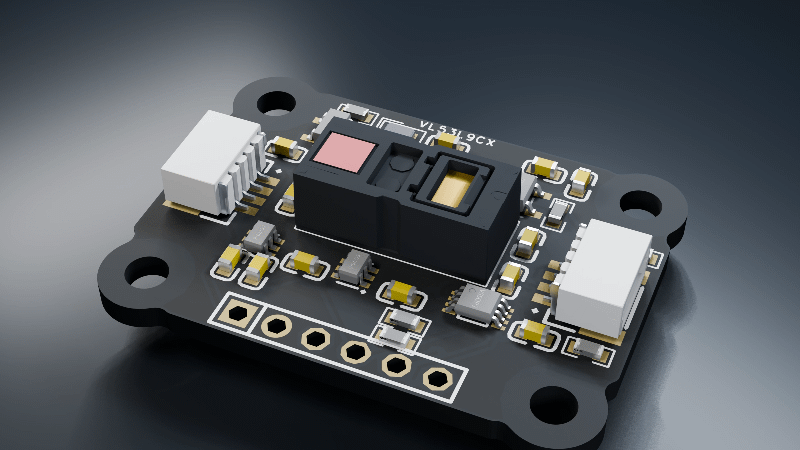

# VL53L9CX Breakout Board

## Video link

[View the board assembly animation](images/vl53l9cx-breakout-board-assembly.gif)

## Project introduction

A compact hardware breakout for STMicroelectronics’ VL53L9CX direct time-of-flight sensor. It connects the sensor to a 3.3 V host over I²C or I3C and provides two Qwiic connectors plus a 6-pin host header.

## Project function

- Exposes the VL53L9CX SDA, SCL, interrupt, and sync signals to a host.
- Translates the host’s 3.3 V I²C/I3C bus to the sensor’s 1.8 V I/O domain.
- Provides the sensor’s 1.8 V and 1.2 V rails from a regulated 3.3 V input.
- Supplies the sensor with an onboard 24 MHz clock.

## Project Parameters

| Parameter | Value |
| --- | --- |
| Board input | Regulated 3.3 V |
| Host logic | 3.3 V |
| Sensor rails | AVDD/VBAT 3.3 V, IOVDD 1.8 V, DVDD 1.2 V |
| Bus | I²C/I3C on shared SDA/SCL lines |
| External clock | 24 MHz |
| Connectors | 2 Qwiic connectors; 1 × 6-pin, 2.54 mm header |

**Qwiic pinout:** 1 GND, 2 3V3, 3 SDA, 4 SCL.

**Host header:** 1 3V3, 2 GND, 3 SDA, 4 SCL, 5 INT, 6 SYNC.

## Principle analysis (hardware description)

The board is organized into four functional sections:

1. **Power:** two onboard regulators generate the sensor’s 1.8 V I/O and 1.2 V core supplies. The sensor’s AVDD and VBAT pins use the 3.3 V input.
2. **Sensor and clock:** the VL53L9CX connects to the host bus and receives a 24 MHz clock from the onboard oscillator.
3. **I²C/I3C translation:** a TCA39306 translates SDA and SCL between the 3.3 V host and 1.8 V sensor domains.
4. **Control signals:** level translators carry INT from the sensor to the host and SYNC from the host to the sensor.

## Software code

This repository contains hardware files and reference images; it does not include host firmware. Configure the host driver for the board’s 3.3 V AVDD, 1.8 V IOVDD, and 24 MHz external clock. See the [VL53L9CX datasheet](https://www.st.com/resource/en/datasheet/vl53l9cx.pdf).

## Announcements

- Power the board from a regulated 3.3 V supply. Do not connect 5 V to the 3V3 input.
- The editable EasyEDA schematic/PCB project and source 3D model are not included in this repository.
- The blue views below show an alternate appearance of the same board layout.

## Assembling processes

1. Fabricate the 4-layer PCB using the [Gerber and drill archive](manufacturing/vl53l9cx-breakout-gerber-and-drill.zip); review the fabricator’s layer, drill, and outline preview.
2. Assemble components using the [BOM](manufacturing/vl53l9cx-breakout-bill-of-materials.xlsx) and [pick-and-place file](manufacturing/vl53l9cx-breakout-pick-and-place.xlsx).
3. Check component orientation and soldering, then power the board from regulated 3.3 V.
4. Connect the host over I²C or I3C and configure its VL53L9CX driver.

The [interactive BOM](manufacturing/vl53l9cx-breakout-interactive-bom.html) can be downloaded and opened in a browser. The manufacturing files’ hashes are in [SHA256SUMS](manufacturing/SHA256SUMS).

## Finished product display

| Blue PCB — top | Blue PCB — bottom |
| --- | --- |
|  |  |

## License

See [LICENSE](LICENSE).
