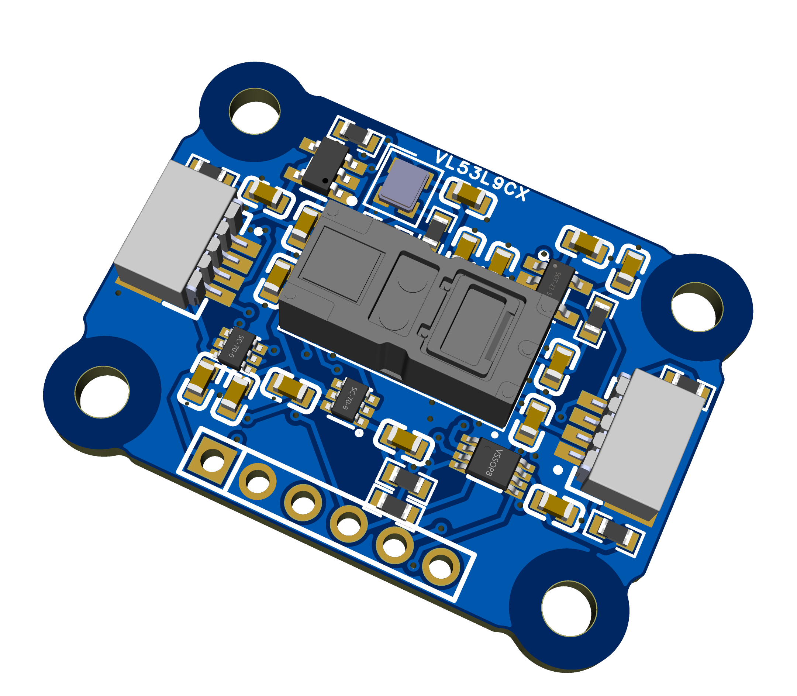
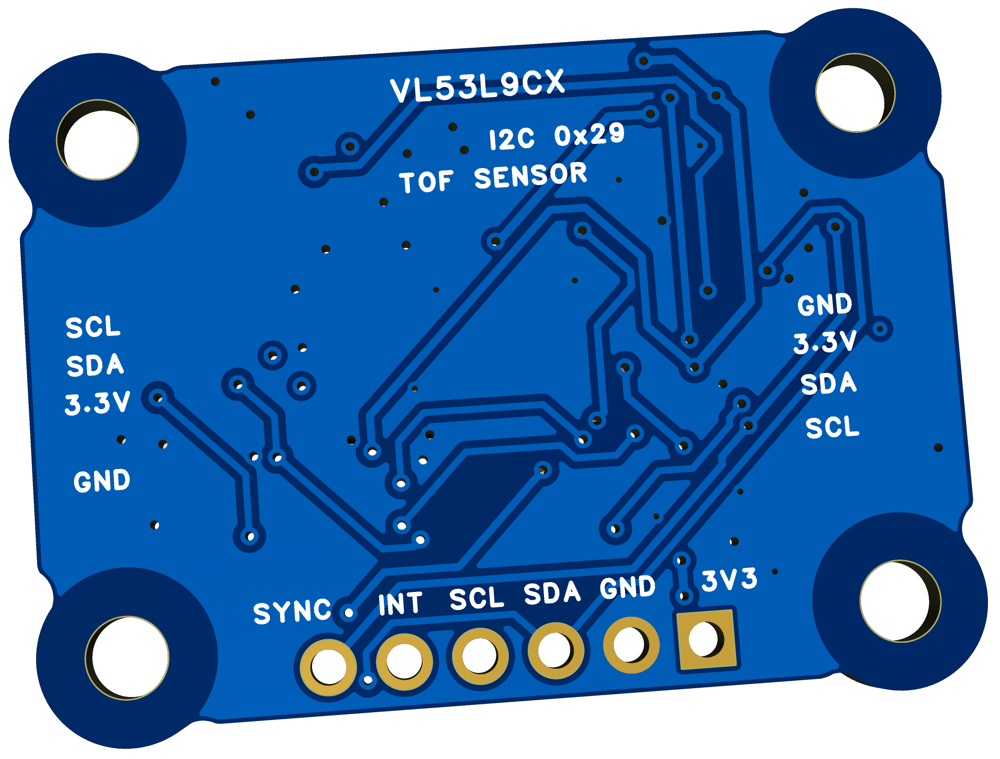

# VL53L9CX Breakout Board

## Blue PCB variant

| Top side | Bottom side |
| --- | --- |
|  |  |

A compact carrier for STMicroelectronics’ VL53L9CX direct time-of-flight sensor. It provides a 3.3 V host interface, onboard sensor power rails, I²C/I3C bus translation, and an external 24 MHz clock.

## Board overview

| Feature | Details |
| --- | --- |
| Input | Regulated 3.3 V |
| Host logic | 3.3 V |
| Sensor rails | AVDD/VBAT: 3.3 V; IOVDD: 1.8 V; DVDD: 1.2 V |
| Host bus | I²C or I3C on shared SDA/SCL lines, translated to the sensor’s 1.8 V I/O domain |
| Clock | Onboard 24 MHz oscillator |
| Connectors | Two Qwiic connectors and one 6-pin, 2.54 mm host header |

### Connector pinout

| Pin | Qwiic connectors | Host header |
| ---: | --- | --- |
| 1 | GND | 3V3 |
| 2 | 3V3 | GND |
| 3 | SDA | SDA |
| 4 | SCL | SCL |
| 5 | — | INT |
| 6 | — | SYNC |

Use a regulated 3.3 V supply. Do not apply 5 V to the board’s 3V3 input.

## Manufacturing files

The `manufacturing/` directory contains fabrication and assembly outputs:

- [Gerber and drill archive](manufacturing/vl53l9cx-breakout-gerber-and-drill.zip) — four copper layers, solder mask, silkscreen, paste, board outline, and drill data.
- [Bill of materials](manufacturing/vl53l9cx-breakout-bill-of-materials.xlsx)
- [Pick-and-place file](manufacturing/vl53l9cx-breakout-pick-and-place.xlsx)
- [Interactive BOM](manufacturing/vl53l9cx-breakout-interactive-bom.html) — download and open in a browser.
- [Manufacturing checksums](manufacturing/SHA256SUMS)

### Fabrication and assembly

1. Upload the Gerber ZIP to the board fabricator and review its layer and drill preview.
2. Confirm the board outline, layer count, and fabrication preview before ordering.
3. For assembly, provide the BOM and pick-and-place file; review part substitutions, rotations, and placements in the assembler’s preview.

## Schematic and editable EasyEDA project

- [Schematic PDF](schematic/vl53l9cx-breakout-schematic.pdf) — printable full-sheet schematic.
- [Schematic SVG](schematic/vl53l9cx-breakout-schematic.svg) — vector version for zooming in without losing detail.
- [Editable EasyEDA Pro project](easyeda/vl53l9cx-breakout-editable.epro2) — native project archive with the schematic and PCB design.

To edit the project, download the `.epro2` file and import it in EasyEDA Pro from the start page or with **File → Import → EasyEDA Professional**. The archive is a copy of the project at the time of export; edits made after downloading will not sync back to this GitHub repository. See [EasyEDA Pro’s import guide](https://prodocs.easyeda.com/en/import-export/import-easyeda-pro/index.html).

## Repository contents

- `manufacturing/` — Gerber, drill, BOM, assembly-placement, and interactive BOM files.
- `images/` — product renders and a [schematic preview](images/schematic-vl53l9cx-breakout-board.png).
- `schematic/` — full-sheet schematic exports in PDF and SVG formats.
- `easyeda/` — editable EasyEDA Pro project archive.
- `LICENSE` — license terms for this repository.

## Reference

[VL53L9CX datasheet — STMicroelectronics](https://www.st.com/resource/en/datasheet/vl53l9cx.pdf)
